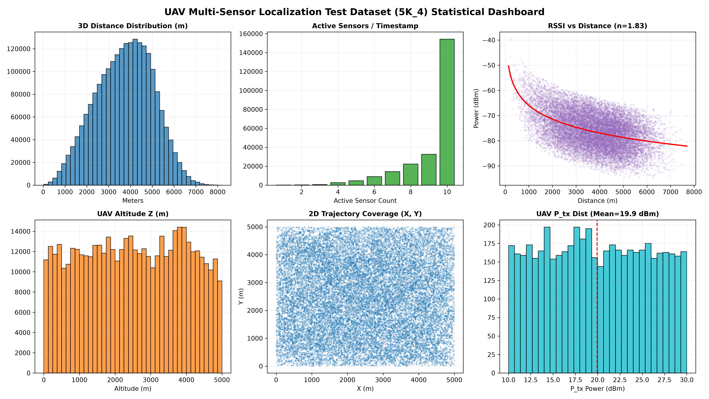

# Transformer-Based UAV Localization with Multi-Sensors

Locating a drone in 3D from the signal strength (RSSI) it leaves on a network of passive ground RF sensors.

The model is called **SeqED**, a two-stage sequence encoder–decoder. A **Hybrid Spatiotemporal Transformer encoder** learns a representation of the multi-sensor, multi-sector RSSI stream. A light **LSTM decoder** turns that representation into a continuous UAV position $(x, y, z)$. SeqED never needs the drone's transmit power. It is compared with classical **path-loss trilateration** and a **weighted centroid** on clean data, on a new terrain (**Mountains**) and under three levels of receiver noise. For each new condition, only the decoder is fine-tuned.

The final experiments live in [`Final Tests/`](Final%20Tests/), a frozen, self-contained evaluation bundle. All results in this README come from there.

---

## Table of Contents
1. [The Problem](#the-problem)
2. [System Workflow](#system-workflow)
3. [Data](#data)
4. [Model](#model)
5. [Training Phase](#training-phase)
6. [Baselines](#baselines)
7. [Final Experiments: Setting](#final-experiments-setting)
8. [Final Experiments: Results](#final-experiments-results)
9. [Repository Layout](#repository-layout)
10. [Setup and Usage](#setup-and-usage)
11. [Outputs and Metrics](#outputs-and-metrics)
12. [Further Documentation](#further-documentation)

---

## The Problem

A UAV transmitting at 433 MHz flies over a 5 km × 5 km area watched by **10 passive ground sensors**. Each sensor has **6 directional antenna sectors**. At every time step it reports which sector detected the drone and the received power in dBm. The sensors do not know the drone's transmit power $P_{tx}$, which ranges from 10 to 30 dBm.

**Goal:** estimate the drone's 3D position at every time step from these readings alone.

Classical methods turn RSSI into distance with a path-loss model and then solve for position. This works well when $P_{tx}$ is known exactly, but it breaks down when $P_{tx}$ is even slightly wrong. This project tests whether a learned model, which never sees $P_{tx}$, is more robust. It also tests how well the model transfers to new terrain and to noisy receivers.

---

## System Workflow

```
 Raw simulator CSVs (per 5K-experiment folder)
   │  sensor_detection_summary, sensor_information, sensor_distances,
   │  drone_information, drone_trajectories
   ▼
 Preprocessing ── one dense row per (experiment, sensor, time step), 18 columns
   │               (6 sector powers, sensor xyz, hardware, target uav xyz)
   ▼
 Sliding windows ── 40 rows = 4 time steps × 10 sensors, stride 1
   │
   ├── Stage 1: train the Transformer encoder (self-supervised, clean data)
   ├── Stage 2: freeze the encoder, train the LSTM decoder (positions, clean data)
   ├── Stage 3: per new condition, fine-tune only the decoder
   │            (Mountains, noise −110 / −100 / −90 dBm)
   ▼
 Final Tests ── raw test CSVs ─► every predictor ─► per-time-step positions
                                                  ─► metrics, summaries, pivot tables
```

1. **Data.** A simulator produces one folder per 5,000 experiments. One experiment is one drone trajectory.
2. **Preprocessing.** The raw tables are joined into the dense 18-column layout described in [Data](#data). Every sensor has a row at every time step, and sectors with no detection hold 0.
3. **Training.** The encoder and decoder are trained on clean, flat-terrain data. Both stages are described in [Training Phase](#training-phase).
4. **Adaptation.** For Mountains and each noise level, the encoder stays frozen and only the decoder is fine-tuned on data from that condition.
5. **Evaluation.** `Final Tests/run_evaluation.py` feeds the **raw CSV tables** of each test experiment to every predictor. Each predictor does its own preprocessing, so the measured time covers the full path from raw data to position.

---

## Data

The data is simulated and is not stored in git.

| Dataset | Location | Use |
|---|---|---|
| Clean training set | `Data/train_data_10_sensors_zsectors_ptx_model_preprocessing/5K_0 … 5K_29` | Encoder and decoder training |
| Clean test set | `Data/test_data_10_sensors_zsectors_ptx_model_preprocessing/5K_0 … 5K_4` | Validation during training |
| Mountains | `Data/MountainsData/{train,test}_data_10_sensors_zsectors_ptx_v2_mountains_transformer/` | Decoder fine-tuning on mountain terrain |
| Noise | `Data/noise_data/noise/awgn_f{110,100,90}/{train,test}_data_…/` | Decoder fine-tuning per noise level |
| Final test sets | `Final Tests/Datasets/{clean,Mountains,noise/background110,background100,background90}/5K_4` | Final evaluation |

### Raw files (one set per folder)
| File | Content |
|---|---|
| `sensor_detection_summary.csv` | Per sensor and timestamp: detected sector(s), received power (dBm), drone position |
| `sensor_information.csv` | Sensor hardware: antenna gain, SINR threshold, sensitivity |
| `sensor_distances.csv` | Sensor positions and sensor–drone distances |
| `drone_information.csv` | Drone transmit power $P_{tx}$ (10–30 dBm), antenna gain, frequency |
| `drone_trajectories.csv` | Ground-truth trajectory (start and end position per step) |
| `sensor_gain_sectors.csv`, `phi_sector_scheme.csv` | Sector antenna pattern definitions |

### Model input: the 18-column layout
| Columns | Meaning | Scaling |
|---|---|---|
| `experiment_id, sensor_id, time_step` | Indexing | — |
| `sector_1_power … sector_6_power` | RSSI per antenna sector (dBm, 0 = no detection) | raw dBm |
| `sensor_x, sensor_y, sensor_z` | Sensor position | km |
| `gain, sinr_threshold, sensitivity` | Sensor hardware | gain raw, SINR ÷10, sensitivity ÷90 |
| `uav_x, uav_y, uav_z` | Ground-truth UAV position (target) | km |

A model **window is 40 consecutive rows**, i.e. **4 time steps × 10 sensors**.

**Where the RSSI is measured.** In the clean data, the RSSI of a trajectory step is measured at its start position. The Mountains and noise simulators measure it at the end position. All preprocessing and evaluation code detects this from the detections' drone positions and uses the matching side as ground truth.

### Dataset characteristics (clean test set `5K_4`)
| Property | Distribution |
|---|---|
| 3D sensor–UAV distance | Bell-shaped, peak ~4–5 km, range 0–8 km |
| UAV altitude (Z) | Roughly uniform, 0–5 km |
| 2D trajectory coverage | Uniformly dense across the 5 km × 5 km grid |
| Active sensors per time step | Strongly skewed toward 9–10 |
| UAV transmit power $P_{tx}$ | Near-uniform 10–30 dBm, mean ≈ 19.9 dBm |
| RSSI vs. distance | Log-distance path loss, fitted exponent n ≈ 1.83, high variance |



*Generated by `scripts/analysis/data_analysis.py`.*

---

## Model

```
 Window: 40 rows (4 time steps × 10 sensors)
   │
   ├─ sector_1..6 power ──► SparseDynamicEncoder ─┐
   ├─ gain, SINR, sens. ──► StaticContextEncoder  ├─► concat ─► Linear fusion ─► LayerNorm ──► fused embedding (d=128)
   ├─ sensor x, y, z ─────► Spatial pos. encoding │       (Cartesian + spherical basis)              │
   └─ row index ──────────► Temporal pos. encoding┘                                                   │
                                                                                                      │
  Stage 1 (self-supervised pre-training):                                                             │
     fused embedding ─► causal Transformer (3 layers, 8 heads) ─► predict next row's 6 sector powers ◄┤
                                                                                                      │
  Stage 2 (localization):                                                                             │
     fused embedding ─► LSTM decoder (Linear 128→256, 2-layer LSTM, FC) ─► (x, y, z) in km  ◄─────────┘
```

- **Encoder** (`src/models/hybrid_encoder.py`). Each row's sector powers, sensor hardware, sensor position and row position get their own embedding. The four are fused into one 128-d vector.
- **Decoder** (`src/models/lstm_decoder.py`). It reads the encoder's fused embedding for every row of the window and outputs a position. The position of the window's last row is the prediction.
- **Inference** (`src/predictors/encoder_decoder_predictor.py`). `EncoderDecoderPredictor` takes the raw CSV tables of one experiment. It densifies and normalises them, cuts stride-1 windows, and runs the encoder and decoder on the GPU in batches. It outputs one position per time step from the 4th time step onwards, because the first full window ends there.

---

## Training Phase

Training uses the clean, flat-terrain data. Fine-tuning then adapts the decoder to each new condition.

### Stage 1: encoder pre-training
- **Script:** `scripts/train/train_hybrid.py`, writing to `models/encoder/`.
- **Objective:** autoregressive next-row prediction. A causal Transformer predicts the next row's 6 sector powers from the rows so far. The loss is MSE, and the first 10 positions are skipped as warm-up. No position labels are used, so the encoder learns the structure of the RSSI field itself.
- **Settings:** Adam, lr 1e-4, batch 512, mixed precision. Data is the 30 clean training folders, about 150,000 experiments.
- **Selected checkpoint:** epoch 16, `hybrid_predictor_10sensors_16_epochs.pth`.

### Stage 2: decoder training
- **Script:** `scripts/train/train_lstm.py`, writing to `models/decoder/`.
- **Objective:** MSE between the last row's predicted and true `uav_x, uav_y, uav_z`, in km. The encoder is frozen and the decoder reads its fused embedding.
- **Settings:** Adam, lr 1e-4, batch 512, 15 epochs.
- **Selected checkpoint:** epoch 12, the lowest validation loss, `decoder_10sensors_12_epochs.pth`. This is **SeqED Basic** in the results.

### Stage 3: decoder fine-tuning per condition
The encoder stays frozen. The decoder starts from the epoch-12 weights and is trained with a 10× lower learning rate. The checkpoint with the lowest validation loss is kept. This is **SeqED Fine-tuned** in the results.

| Setting | Value |
|---|---|
| Optimizer | Adam, lr 1e-5, no weight decay |
| Batch size | 512 |
| Gradient clipping | max norm 1.0 |
| Windows | 40 rows, stride 1, same targets as Stage 2 |
| Training data | 40 folders × 5,000 experiments of the target condition |
| Validation data | the condition's test folders `5K_0 … 5K_4` |

| Condition | Script folder | Epochs run | Best epoch | Val. 3D mean error before | Val. 3D mean error after |
|---|---|---|---|---|---|
| Mountains | `scripts/finetune_mountains/` | 2 | 1 | 94 m | 43 m |
| Noise −110 dBm | `scripts/finetune_noise/` (`awgn_f110`) | 8 | 2 | 238 m | 129 m |
| Noise −100 dBm | `scripts/finetune_noise/` (`awgn_f100`) | 4 | 1 | 580 m | 238 m |
| Noise −90 dBm | `scripts/finetune_noise/` (`awgn_f90`) | 5 | 2 | 1253 m | 502 m |

In every condition, validation loss stopped improving after one or two epochs while training loss kept falling.

> **Note:** the validation folders include `5K_4`, the same file used for the final test. Validation was used only to pick the best epoch among a few, but the fine-tuned results are therefore not on fully held-out data.

The fine-tuned weights used in the final tests are copied to `Final Tests/models/finetuned/{mountains,noise_f110,noise_f100,noise_f90}/`. All four share the file name `decoder_mountains_finetuned_best.pth`.

---

## Baselines

All predictors share the `BaseUAVPredictor` interface (`src/predictors/base_predictor.py`). Each receives the same raw tables per experiment and is scored by the same `evaluate()` function.

| Predictor | Method | Needs $P_{tx}$? |
|---|---|---|
| **SeqED Basic** | Encoder epoch 16 + decoder epoch 12, trained on clean data | **No** |
| **SeqED Fine-tuned** | Same encoder + decoder fine-tuned for the test condition | **No** |
| **RSSI Trilateration** | Log-distance path loss (exponent 2.0) turns RSSI into a range per sensor. A weighted-centroid guess seeds a bounded non-linear least-squares fit (SciPy TRF) inside $[0, 5000]^3$ m. | **Yes**, the true value from `drone_information.csv` |
| **RSSI Trilateration (1 dB uncertainty)** | Same, with $P_{tx}$ shifted by +1 dB | **Yes**, off by 1 dB |
| **WCL** | Weighted centroid of sensor positions, weighted by linear received power | No |

Trilateration with the true $P_{tx}$ is an optimistic upper bound, because a passive network does not know the drone's transmit power. The 1 dB case models a small, realistic error in that value.

The full derivations of WCL and trilateration are in [`scripts/README.md`](scripts/README.md).

---

## Final Experiments: Setting

All final numbers come from `Final Tests/run_evaluation.py`, run on the BGU SLURM cluster.

### Test datasets
Each dataset is one test folder `5K_4` with 10 sensors.

| Dataset | Condition | Experiments | Time steps (baselines / SeqED) |
|---|---|---|---|
| `clean` | Flat terrain, no added noise. The training distribution. | 5,000 | 240,517 / 225,721 |
| `mountains` | Mountain terrain, no added noise | 5,000 | 238,479 / 223,717 |
| `noise_-110` | Receiver noise, background noise floor −110 dBm (mild) | 5,000 | 238,491 / 223,729 |
| `noise_-100` | Receiver noise, background noise floor −100 dBm | 5,000 | 238,411 / 223,649 |
| `noise_-90` | Receiver noise, background noise floor −90 dBm (strongest) | 4,993 | 229,042 / 214,352 |

The noise datasets were produced by the simulator with additive white Gaussian noise (AWGN) at the given noise floor. A higher noise floor means weaker signals are buried deeper in noise.

SeqED has about 6% fewer time steps because it starts predicting at the 4th time step of each experiment, when the first full window is available. The baselines predict from the first time step.

### Protocol
- **Predictors:** the five listed in [Baselines](#baselines). There is no fine-tuned model for `clean`, so SeqED Fine-tuned is skipped there.
- **Hardware:** trilateration and WCL run on CPU. SeqED runs on one NVIDIA RTX 4090 GPU.
- **Timing:** each predictor gets one untimed warm-up call. **Latency** covers model computation only, meaning the solver for trilateration and WCL and the forward pass for SeqED. **Preprocessing** covers data preparation, and **end-to-end** is their sum. SeqED processes all windows of an experiment in batches, so its per-time-step latency is amortised over a batch.
- **Ground truth:** the drone position at the side of the trajectory step where the RSSI was measured.

---

## Final Experiments: Results

All numbers are in metres unless stated otherwise. Lower is better. Bold marks the best method that does not need the exact $P_{tx}$. Source files are in `Final Tests/results/`.

### 3D mean error (m)
| Predictor | clean | mountains | noise −110 | noise −100 | noise −90 |
|---|---|---|---|---|---|
| Trilateration (true $P_{tx}$) | 20 | 24 | 154 | 432 | 1212 |
| Trilateration (1 dB error) | 618 | 617 | 645 | 787 | 1374 |
| WCL | 2855 | 2813 | 2818 | 2818 | 2784 |
| SeqED Basic | **40** | 78 | 223 | 554 | 1163 |
| SeqED Fine-tuned | — | **43** | **127** | **234** | **451** |

### 3D median error (m)
| Predictor | clean | mountains | noise −110 | noise −100 | noise −90 |
|---|---|---|---|---|---|
| Trilateration (true $P_{tx}$) | 12 | 11 | 79 | 231 | 638 |
| Trilateration (1 dB error) | 578 | 570 | 579 | 621 | 819 |
| WCL | 2866 | 2795 | 2799 | 2798 | 2734 |
| SeqED Basic | **28** | 30 | 128 | 350 | 844 |
| SeqED Fine-tuned | — | **28** | **82** | **162** | **315** |

### 3D RMSE and 95th-percentile error (m)
| Predictor | Metric | clean | mountains | noise −110 | noise −100 | noise −90 |
|---|---|---|---|---|---|---|
| Trilateration (true $P_{tx}$) | RMSE | 174 | 227 | 324 | 771 | 1825 |
| | P95 | 27 | 27 | 514 | 1445 | 4490 |
| Trilateration (1 dB error) | RMSE | 665 | 679 | 716 | 990 | 1888 |
| | P95 | 976 | 978 | 1105 | 1714 | 4501 |
| WCL | RMSE | 3178 | 3139 | 3143 | 3144 | 3126 |
| | P95 | 4992 | 4988 | 4993 | 4993 | 5031 |
| SeqED Basic | RMSE | **92** | 203 | 353 | 807 | 1517 |
| | P95 | **94** | 336 | 762 | 1779 | 3223 |
| SeqED Fine-tuned | RMSE | — | **97** | **189** | **321** | **602** |
| | P95 | — | **111** | **383** | **678** | **1288** |

### Horizontal (2D) and altitude (Z) mean error (m)
| Predictor | Metric | clean | mountains | noise −110 | noise −100 | noise −90 |
|---|---|---|---|---|---|---|
| Trilateration (true $P_{tx}$) | 2D | 10 | 13 | 135 | 374 | 859 |
| | Z | 15 | 18 | 54 | 157 | 696 |
| Trilateration (1 dB error) | 2D | 423 | 424 | 455 | 595 | 968 |
| | Z | 387 | 385 | 385 | 410 | 793 |
| WCL | 2D | 1280 | 1265 | 1275 | 1276 | 1299 |
| | Z | 2445 | 2402 | 2401 | 2401 | 2343 |
| SeqED Basic | 2D | **28** | 53 | 168 | 403 | 801 |
| | Z | **24** | 47 | 120 | 317 | 717 |
| SeqED Fine-tuned | 2D | — | **30** | **87** | **149** | **245** |
| | Z | — | **26** | **77** | **155** | **335** |

### Trajectory step loss (m)
Error of the step-to-step displacement vector. Lower means a smoother, more consistent track.

| Predictor | clean | mountains | noise −110 | noise −100 | noise −90 |
|---|---|---|---|---|---|
| Trilateration (true $P_{tx}$) | 3.7 | 4.2 | 209 | 560 | 1123 |
| Trilateration (1 dB error) | 28.8 | 30.3 | 234 | 619 | 1233 |
| WCL | 79.3 | 81.2 | 102 | 172 | 450 |
| SeqED Basic | **8.2** | 11.8 | 232 | 502 | 806 |
| SeqED Fine-tuned | — | **9.4** | **58** | **102** | **178** |

### Time per time step (ms)
| Predictor | Device | Latency (model only) | Preprocessing | End-to-end |
|---|---|---|---|---|
| Trilateration (true $P_{tx}$) | CPU | 3.4 – 6.1 | 60 – 78 | 63 – 84 |
| Trilateration (1 dB error) | CPU | 5.2 – 6.9 | 59 – 81 | 64 – 87 |
| WCL | CPU | 0.04 – 0.06 | 3.2 – 3.8 | 3.2 – 3.8 |
| SeqED Basic | GPU | 0.08 | 40 – 41 | 40 – 41 |
| SeqED Fine-tuned | GPU | 0.08 | 39 – 41 | 39 – 41 |

Ranges span the five datasets.

### Takeaways
- **Exact $P_{tx}$ makes trilateration the most accurate on clean data,** at 20 m versus 40 m for SeqED. A passive network does not know $P_{tx}$, though.
- **A 1 dB error in $P_{tx}$ costs trilateration about 600 m** on clean and Mountains data. SeqED, which needs no $P_{tx}$, is about 15× more accurate there.
- **Terrain transfer works with decoder-only fine-tuning.** SeqED Basic degrades from 40 m to 78 m on Mountains, and its P95 rises to 336 m. Fine-tuning brings it back to 43 m and a P95 of 111 m, close to its clean-data level.
- **Under receiver noise, fine-tuned SeqED beats every baseline, including trilateration with the exact $P_{tx}$.** It reaches 127, 234 and 451 m against 154, 432 and 1212 m. Fine-tuning cuts SeqED Basic's error by 43–61%.
- **Fine-tuned SeqED gives much smoother tracks under noise.** Its step loss is 4–6× lower than trilateration's.
- **Trilateration has heavy outliers.** On clean data its RMSE is 174 m while its mean is 20 m.
- **WCL is not a usable localizer here.** Its error stays near 2.8 km, mostly in altitude, because a centroid of ground sensors cannot place a drone that flies up to 5 km high.
- **SeqED's model compute is 40–85× faster than trilateration's,** at 0.08 ms against 3–7 ms per time step. End-to-end, SeqED is 1.6–2× faster, and both are dominated by data preparation.

---

## Repository Layout

```
main.py                      Entry point for the research-time grid evaluator (scripts/evaluate/eval_noise_grid.py)
requirements.txt
src/                         Library code (imported, never run directly)
  models/                    hybrid_encoder.py, lstm_decoder.py, positional_encoding.py
  predictors/                base_predictor.py, encoder_decoder_predictor.py,
                             rssi_trilateration_predictor.py, rssi_wcl_predictor.py, rssi_utils.py
  postprocessing/            online_post_processor.py
scripts/                     Runnable entry points
  data/                      download_drive_data.py, data_preprocessing.py, build_dataset_cache.py
  train/                     train_hybrid.py, train_lstm.py
  evaluate/                  eval_noise_grid.py
  finetune_mountains/        preprocess_mountains.py, finetune_decoder.py, resume_finetune.py, eval_mountains.py
  finetune_noise/            preprocess_noise.py, finetune_decoder.py, resume_finetune.py, eval_noise.py,
                             run_pipeline_awgn_f{110,100,90}.bat
  finetune_clean/            Decoder fine-tuning on clean data (not part of the final evaluation)
  analysis/                  data_analysis.py, plot_results.py, visualize_experiment*.py
Final Tests/                 Frozen final evaluation bundle
  run_evaluation.py          Runs all predictors on all five test datasets
  src/                       Copy of src/ (predictors also record preprocessing time separately)
  models/                    Encoder, decoder and fine-tuned decoder weights (local only)
  Datasets/                  The five 5K_4 test folders (local only)
  results/                   Summary and pivot CSVs (in git); per-time-step predictions (local only)
models/                      Trained weights and training logs (local only)
outputs/                     Plots
Data/                        Datasets and caches (local only, hundreds of GB)
archive/                     Legacy scripts, see archive/README.md
```

Weights, datasets, caches and per-time-step prediction CSVs are **not** stored in git (see `.gitignore`).

---

## Setup and Usage

```bash
pip install -r requirements.txt
```

Python 3.8+, PyTorch (a CUDA GPU is strongly recommended), NumPy, Pandas, SciPy, scikit-learn, Matplotlib, tqdm, gdown. Every script finds its paths from its own location, so the folder you launch from does not matter.

### 1. Prepare the clean data
```bash
python scripts/data/download_drive_data.py          # download the training set from Google Drive
python scripts/data/data_preprocessing.py           # build normalized_data.csv in each folder
python scripts/data/build_dataset_cache.py          # build Data/cache/{train,test}/subcache_*.pt (40-row windows)
```

### 2. Train the encoder and decoder
```bash
python scripts/train/train_hybrid.py     # Stage 1 → models/encoder/hybrid_predictor_10sensors_{N}_epochs.pth
python scripts/train/train_lstm.py       # Stage 2 → models/decoder/decoder_10sensors_{N}_epochs.pth
```
> `train_hybrid.py` currently **resumes** from the epoch-17 checkpoint (`start_epoch=17`). Edit `main()` to train from scratch.

### 3. Fine-tune the decoder per condition
```bash
# Mountains
python scripts/finetune_mountains/preprocess_mountains.py   # raw CSVs → .npy cache
python scripts/finetune_mountains/finetune_decoder.py       # → scripts/finetune_mountains/checkpoints/
python scripts/finetune_mountains/resume_finetune.py --epochs 5

# Noise, one run per level; outputs go to scripts/finetune_noise/runs/<level>/
python scripts/finetune_noise/preprocess_noise.py --raw_dir Data/noise_data/noise/awgn_f100
python scripts/finetune_noise/finetune_decoder.py --raw_dir Data/noise_data/noise/awgn_f100
scripts\finetune_noise\run_pipeline_awgn_f100.bat           # or the whole pipeline on Windows
```
Main fine-tuning options: `--epochs` (10), `--lr` (1e-5), `--batch_size` (512), `--train_stride` (1), `--grad_clip` (1.0). Run any script with `--help` for the full list.

### 4. Run the final evaluation
Copy the best checkpoints into `Final Tests/models/finetuned/<condition>/` and the test folders into `Final Tests/Datasets/`, then:
```bash
cd "Final Tests"
python run_evaluation.py --max_exps 10                                                    # quick check
python run_evaluation.py --max_exps 0 --predictors trilateration wcl                      # CPU predictors, all experiments
python run_evaluation.py --max_exps 0 --predictors seqed_basic seqed_finetuned            # GPU predictors
python run_evaluation.py --datasets mountains noise_-100 --max_exps 0                     # selected datasets
```

| Flag | Default | Description |
|---|---|---|
| `--datasets` | all five | `clean mountains noise_-110 noise_-100 noise_-90` |
| `--predictors` | all four groups | `trilateration wcl seqed_basic seqed_finetuned` |
| `--max_exps` | 100 | Experiments per dataset; `0` means all |
| `--ptx_uncertainties` | 0 1 | $P_{tx}$ offsets in dB; trilateration runs once per value |
| `--num_sensors` | 10 | Sensors in the dataset |
| `--sequence_size` | 40 | SeqED window in rows (4 × `num_sensors`) |
| `--output_dir` | `results/` | Where result CSVs are written |

Separate CPU, GPU and per-dataset runs can be combined. After every run, `all_summary.csv` and the pivot tables are rebuilt from all summary files on disk.

---

## Outputs and Metrics

| File (under `Final Tests/results/`) | Content |
|---|---|
| `<dataset>/summary_<group>.csv` | One row per predictor with all metrics |
| `<dataset>/predictions_<group>.csv` | Per-time-step predicted and true position (local only, large) |
| `all_summary.csv` | Every metric, one row per (dataset, predictor) |
| `pivot_<metric>.csv` | Predictor × dataset table for each main metric |

**Metrics** (`BaseUAVPredictor.evaluate`):
- **3D Euclidean error:** mean, median, std, RMSE, P90, P95, min, max
- **2D (horizontal) error:** mean, median, std, P90, P95
- **Z (altitude) error:** mean, median, P95
- **Trajectory step loss:** error of the step-to-step displacement vector
- **MSE in km²:** per axis and overall, comparable to the training loss
- **Timing:** latency per time step, preprocessing per time step, end-to-end per time step, throughput

---

## Further Documentation
- [`scripts/README.md`](scripts/README.md): mathematical derivations of WCL, trilateration and the evaluation metrics.
- [`archive/README.md`](archive/README.md): legacy scripts.
